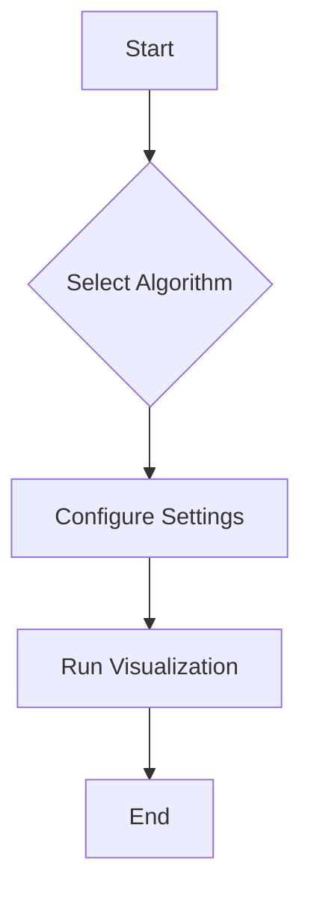

```markdown
# 🎨 AlgoVisuals:  A Webapp to Visualize Sorting Algorithms 🚀

```ascii
                                    _,-._
                                   / \_/ \
                                  >-(_)-<
                                  \_/ \_/
                                     `-'
                    AlgoVisuals:  Visualizing Algorithms Made Easy!
```

[](https://github.com/Manas-Pathak/AlgoVisuals/stargazers)
[](https://github.com/Manas-Pathak/AlgoVisuals/network)
[](https://github.com/Manas-Pathak/AlgoVisuals/blob/main/LICENSE)
[](https://algo-visuals-xi.vercel.app/)


<br>

## 🌟 Feature Highlights ✨

- 🚀 **Visualize Sorting Algorithms:**  See various sorting algorithms in action, step-by-step.  
- 🎨 **Customizable Visualization:** Adjust speed, array size, and colors for optimal viewing.
- 📚 **Educational Resource:**  Learn how different algorithms work through interactive visualizations.
- ⚡ **Fast and Efficient:** Built with performance in mind for a smooth user experience.
- 📱 **Responsive Design:** Works seamlessly across desktops and mobile devices.
- 🌐 **Open Source:** Contribute to the project and make it even better!


<br>

## 🛠️ Tech Stack 📦

| Technology       | Badge                                                              |
|-----------------|----------------------------------------------------------------------|
| Node.js          | [](https://nodejs.org/) |
| React            | [](https://reactjs.org/)       |
| Redux            | [](https://redux.js.org/)       |
| Material UI      | [](https://mui.com/) |
| JavaScript      | [](https://www.javascript.com/) |


<br>


## 🚀 Quick Start Guide ⚡

1. **Clone the repository:**
   ```bash
   git clone https://github.com/Manas-Pathak/AlgoVisuals.git
   ```

2. **Install dependencies:**
   ```bash
   cd AlgoVisuals
   npm install
   ```

3. **Start the development server:**
   ```bash
   npm start
   ```


<br>

## 📖 Detailed Usage 💡

AlgoVisuals allows you to visualize different sorting algorithms.  You can select an algorithm from the sidebar, adjust the array size (range), speed, and color. Click "play" to start the visualization.

**Code Example (React Component -  Illustrative):**

```javascript
import React from 'react';
// ... other imports

const MyComponent = () => {
  // ... your component logic using AlgoVisuals data
  return (
    <div>
      {/* ... JSX to render AlgoVisuals */}
    </div>
  );
};

export default MyComponent;
```

<br>


## 🏗️ Project Structure 📁

```
AlgoVisuals/
├── public/
│   └── ...
├── src/
│   ├── App.js
│   ├── components/
│   │   ├── Header.js
│   │   ├── Sidebar.js
│   │   ├── Visuals.js
│   │   └── ...
│   ├── reducer/
│   │   ├── index.js
│   │   └── updateProps.js
│   ├── store.js
│   └── index.css
└── package.json
```

<br>

## 🎯 API Documentation 📊

| Function          | Description                                      | Parameters             | Return Value          |
|-------------------|--------------------------------------------------|-------------------------|-----------------------|
| `updateRange()`   | Updates the range of values to be sorted.       | `range` (number)      | None                   |
| `updateSpeed()`   | Updates the speed of the visualization.        | `speed` (number)       | None                   |
| `updateAlgorithm()` | Changes the algorithm to be visualized.           | `algorithm` (string)  | None                   |


<br>

## 🔧 Configuration Options ⚙️

| Option         | Description                                           | Default Value |
|-----------------|-------------------------------------------------------|-----------------|
| `arraySize`    | Number of elements in the array to be sorted.          | 30              |
| `speed`         | Speed of the visualization (milliseconds per step).     | 100             |
| `algorithm`    | Sorting algorithm to visualize.                         | 'bubble'        |


<br>

## 📸 Screenshots/Demo 🖼️

**(Insert screenshots here using markdown image syntax.  Example below)**

[]()
[]()


<br>


## 🤝 Contributing Guidelines 🧑‍💻

We welcome contributions! Please read our [CONTRIBUTING.md](CONTRIBUTING.md) file for guidelines.


<br>


## 📜 License and Acknowledgments 📄

This project is licensed under the MIT License - see the [LICENSE](LICENSE) file for details.


<br>


## 👥 Contributors 🌟

**(Add contributor information here using markdown image syntax for avatars and links to their profiles.)**


<br>


## 📞 Support and Contact 📧

[](https://github.com/Manas-Pathak/AlgoVisuals)
[](https://twitter.com/manaspathak1)  <!-- Replace with actual Twitter link if available -->


<br>


```

